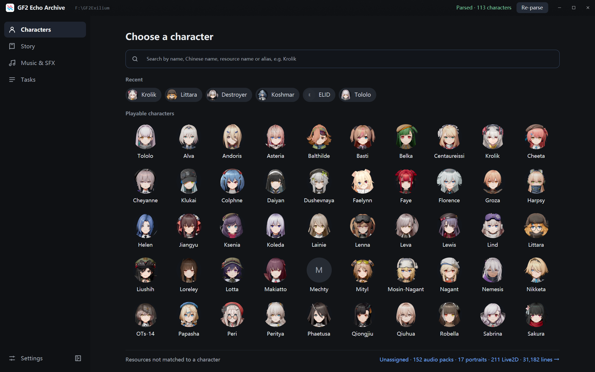
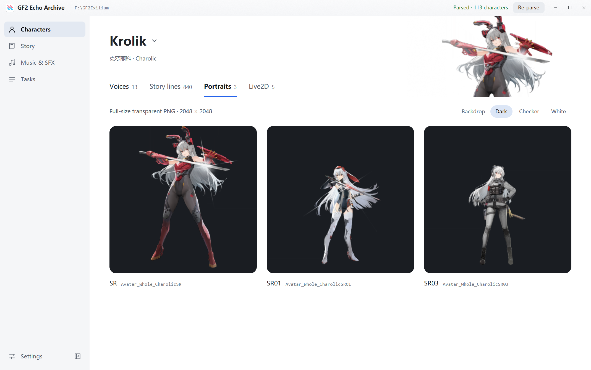
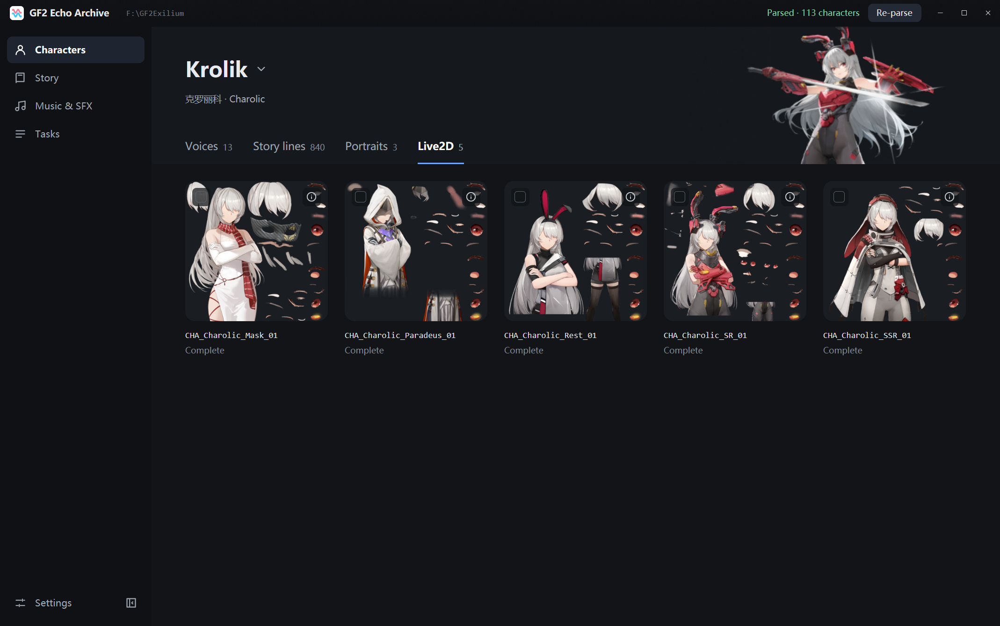
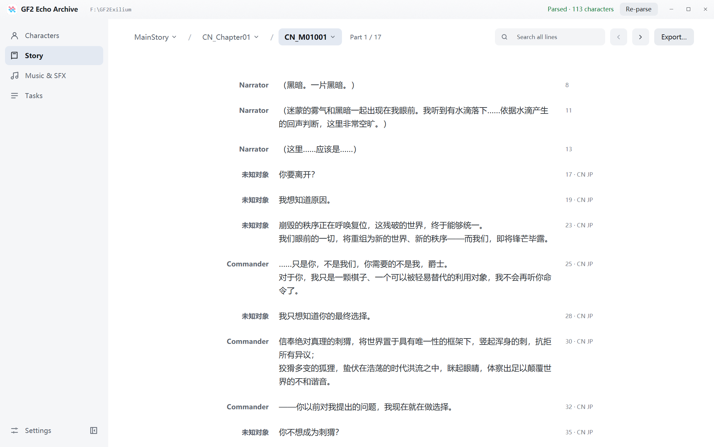
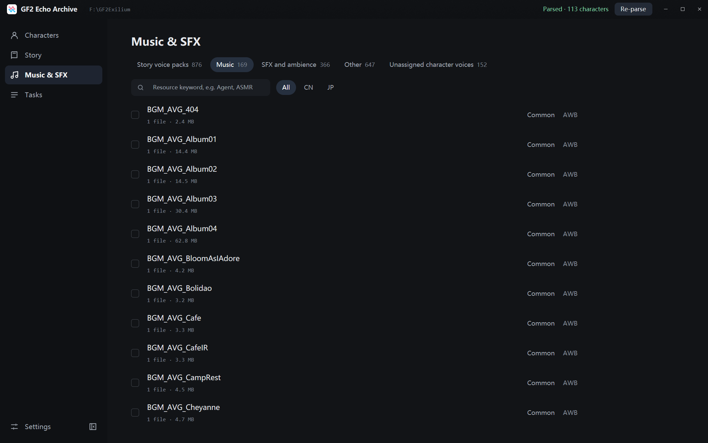

# GF2 Echo Archive

**English** | [简体中文](README.zh_CN.md)

A Windows desktop tool that exports the voice lines, story text, character portraits and Live2D models of **Girls' Frontline 2: Exilium** (少女前线 2：追放, GFL2) from the game files already installed on your PC, and lets you browse them by character.

It only reads local game files. It does not run the game, does not go online and never changes the game files.



<table>
  <tr>
    <td></td>
    <td></td>
  </tr>
  <tr>
    <td align="center">Portraits</td>
    <td align="center">Live2D models</td>
  </tr>
  <tr>
    <td></td>
    <td></td>
  </tr>
  <tr>
    <td align="center">Story reader</td>
    <td align="center">Music &amp; SFX</td>
  </tr>
</table>

## Features

- **Voice and audio**: character voice lines, story voice-over, background music and sound effects, saved as WAV. The game's CRI ACB/AWB/HCA audio is decoded inside the program, no extra tools needed.
- **Story text**: every chapter's script with speakers, exported by character or by chapter, optionally together with the matching voice lines.
- **Portraits**: full-size character art as transparent PNG.
- **Live2D**: complete Live2D model files.
- **By character**: voices, story lines, portraits and Live2D models of each character on one page.
- English and Simplified Chinese interface, dark and light themes.

## How to use

1. Download `gf2_echo_archive.exe` from the [Releases](../../releases) page and put it in an ordinary folder such as `D:\GF2 Echo Archive`. Do not put it under `C:\Program Files`: the program keeps its data next to itself.
2. Double-click to open it. It usually finds the game folder by itself; if not, choose it on the **Settings** page.
3. The first time, click **Parse** at the top of the window and wait for it to finish. Later launches reuse the result.
4. Pick what you want on the **Characters**, **Story** or **Music & SFX** page.
5. Click **Export…** at the bottom and choose where to save. Progress is shown on the **Tasks** page.

Exports go to the `gf2_echo_archive_output` folder next to the program unless you choose another place.

## FAQ

**How do I change the theme or language?**
On the **Settings** page. Both follow the system by default.

**The top bar says "Update available".**
The game has been updated. Click **Update** to read the new content; until then the old content stays usable.

**Some tracks are marked "Tracks to check".**
They are usually silent placeholder tracks in the game and can be ignored. The files are still exported.

**It asks me to choose "Overwrite all".**
The destination already has files with the same names but different content. Choose **Overwrite all** in the export panel to replace them.

**Where are the settings and caches?**
In the `data` folder next to the program; nothing is written to your user folder on drive C. Delete that folder to start over; the next launch will need to parse again.

**The program closed with an error.**
The details are saved in `data\crash.log`. Please attach that file when reporting a problem.

## Disclaimer

This tool is for personal study, technical research and lawful backups only, and is not affiliated with the game's developer or publisher. Game assets belong to their respective rights holders. Do not use it for unauthorised distribution, commercial use or any other unlawful purpose. You are solely responsible for any consequences of using it.

## Building

```powershell
cargo build --release
```

When publishing, ship `gf2_echo_archive.exe` together with `LICENSE` and `THIRD_PARTY_NOTICES.txt`.

Licensed under the [MIT License](LICENSE); third-party licences are in [THIRD_PARTY_NOTICES.txt](THIRD_PARTY_NOTICES.txt). Audio decoding is based on [cridecoder](https://github.com/normalllll/cridecoder); cue naming and error handling follow [vgmstream](https://github.com/vgmstream/vgmstream).
