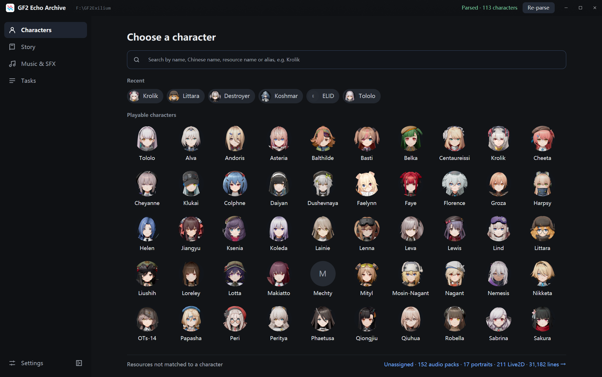
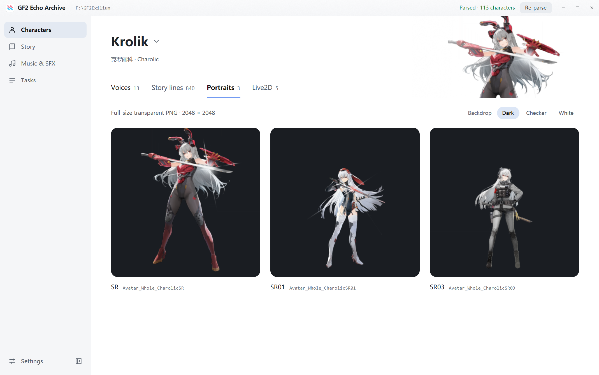
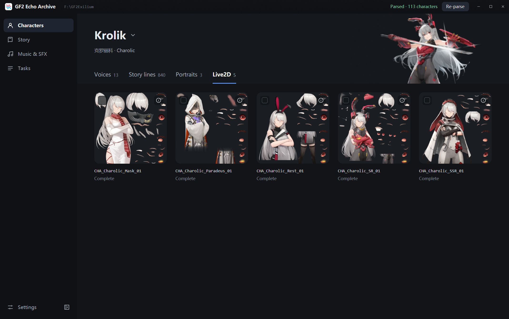
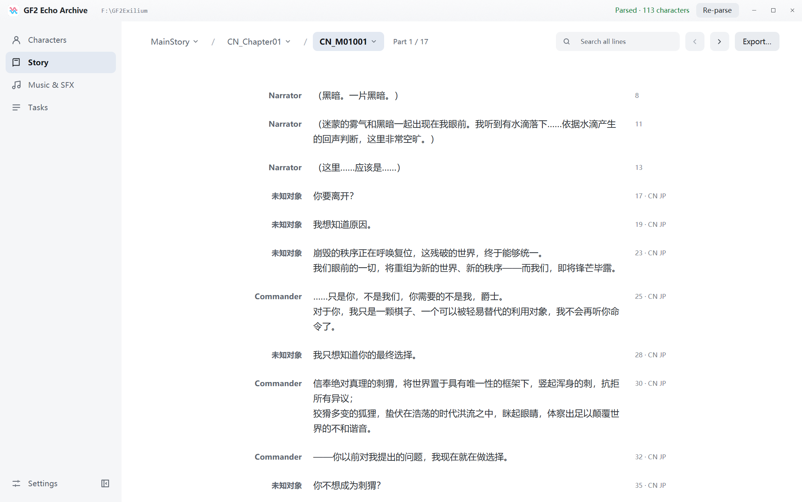
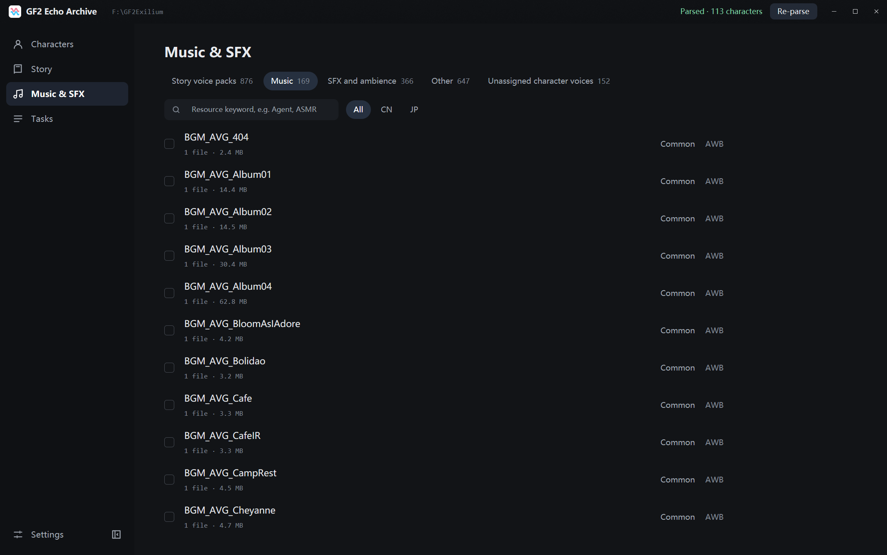

# GF2 Echo Archive

[English](README.md) | **简体中文**

一款 Windows 桌面工具，从电脑上已安装的 **《少女前线 2：追放》**（Girls' Frontline 2: Exilium，少前 2）游戏文件中导出角色语音、剧情台词、角色立绘和 Live2D 模型，并按角色浏览。

只读取本机的游戏文件，不运行游戏，不联网，也不会改动游戏文件。



<table>
  <tr>
    <td></td>
    <td></td>
  </tr>
  <tr>
    <td align="center">立绘</td>
    <td align="center">Live2D 模型</td>
  </tr>
  <tr>
    <td></td>
    <td></td>
  </tr>
  <tr>
    <td align="center">剧情阅读</td>
    <td align="center">音乐与音效</td>
  </tr>
</table>

截图为英文界面。

## 功能

- **语音和音频**：角色语音、剧情语音、背景音乐、音效，保存为 WAV。游戏使用的 CRI ACB/AWB/HCA 音频由程序直接解码，不需要额外工具。
- **剧情台词**：各章节的剧本和说话人，可以按角色或章节导出，也可以连同语音一起导出。
- **立绘**：原尺寸透明 PNG。
- **Live2D**：完整的 Live2D 模型文件。
- **按角色整理**：同一角色的语音、台词、立绘和 Live2D 集中在一页。
- 简体中文和英文界面，深色和浅色主题。

## 怎么用

1. 从 [Releases](../../releases) 页面下载 `gf2_echo_archive.exe`，放到一个普通文件夹里，比如 `D:\GF2 Echo Archive`。不要放在 `C:\Program Files` 里，程序需要在自己旁边保存数据。
2. 双击打开。程序通常会自动找到游戏目录，找不到时到“设置”页手动选择。
3. 第一次使用时，点击窗口顶部的“解析”，等它完成。之后再打开程序会直接沿用结果。
4. 在“角色”“剧情章节”“音乐与音效”页选择想要的内容。
5. 点击底部的“导出…”，选好保存位置。进度可以在“任务”页查看。

导出的文件默认在程序旁边的 `gf2_echo_archive_output` 文件夹里。

## 常见问题

**怎么切换主题和语言？**
在“设置”页，默认都跟随系统。

**顶部显示“发现资源更新”怎么办？**
说明游戏更新过。点击“更新”就会读取新内容，点击之前旧内容仍然可以使用。

**提示有音轨“需要核查”是什么意思？**
通常是游戏里的静音占位音轨，可以忽略。文件仍然会导出。

**提示要选择“全部覆盖”是什么意思？**
保存位置已经有同名但内容不同的文件。想用新文件替换，就在导出面板里选“全部覆盖”。

**程序的设置和缓存放在哪里？**
都在程序旁边的 `data` 文件夹里，不会写入 C 盘的用户目录。删除这个文件夹就能恢复初始状态，下次打开需要重新解析。

**程序报错关闭了怎么办？**
错误信息保存在 `data\crash.log`，反馈问题时请附上这个文件。

## 声明

本工具仅供个人学习、技术研究及合法备份使用，与游戏官方无关。游戏资源的版权归其权利人所有，请勿用于未经授权的传播、商业利用或其他违法违规行为。因使用本工具产生的任何后果，由使用者自行承担。

## 构建

```powershell
cargo build --release
```

发布时请把 `gf2_echo_archive.exe`、`LICENSE` 和 `THIRD_PARTY_NOTICES.txt` 放在一起。

本项目使用 [MIT 许可证](LICENSE)，第三方组件的许可见 [THIRD_PARTY_NOTICES.txt](THIRD_PARTY_NOTICES.txt)。音频解码基于 [cridecoder](https://github.com/normalllll/cridecoder)，音轨命名和容错规则参照 [vgmstream](https://github.com/vgmstream/vgmstream)。
